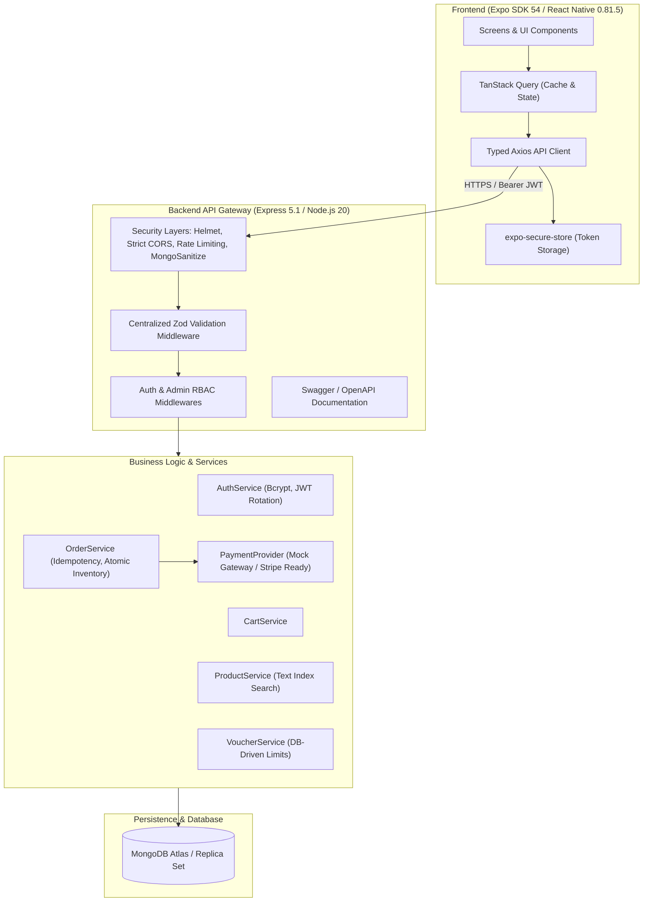

# 👟 KickzStore — Production Sneaker E-Commerce Platform

A production-grade, full-stack sneaker e-commerce mobile application and backend service built with **React Native (Expo SDK 54, React Native 0.81.5, Expo Router 6, TypeScript)** and **Express 5.1 (Node.js 20, Mongoose 8, MongoDB, Zod, JWT/Bcrypt, Supertest/Jest)**.

---

## 📑 Table of Contents
1. [Architecture Overview](#-architecture-overview)
2. [Tech Stack](#-tech-stack)
3. [Security Architecture](#-security-architecture)
4. [Project Structure](#-project-structure)
5. [Quick Start & Setup](#-quick-start--setup)
6. [Environment Variables](#-environment-variables)
7. [API Documentation (Swagger)](#-api-documentation-swagger)
8. [Testing & Quality Verification](#-testing--quality-verification)
9. [Docker & Deployment](#-docker--deployment)
10. [Default Credentials](#-default-credentials)

---

## 🏗️ Architecture Overview

The platform is designed following the **Routes → Controllers → Services → Models** architectural pattern with clear separation of concerns, strict server-side validation, isolated payment abstraction, and resilient mobile state caching.



---

## 💻 Tech Stack

| Layer | Technologies |
|---|---|
| **Mobile Frontend** | React Native 0.81.5, Expo SDK 54.0.37, Expo Router 6.0.24, TypeScript 5.9, React 19.1, `@tanstack/react-query`, `expo-secure-store`, `expo-image`, `axios` |
| **Backend API** | Node.js 20, Express 5.1.0, Mongoose 8.19.1, MongoDB Atlas, Zod 4.6, Bcryptjs 3.0, JSONWebToken 9.0 |
| **Security & Auditing** | `helmet`, `express-rate-limit`, `express-mongo-sanitize`, PCI-DSS CVV discard architecture |
| **Testing & Tooling** | Jest, Supertest, `mongodb-memory-server`, Pino logger, Swagger UI Express |
| **Infrastructure** | Multi-stage Dockerfile, Docker Compose, EAS Build config (`eas.json`), GitHub Actions CI |

---

## 🛡️ Security Architecture

1. **PCI-DSS Compliance (CVV & Card Protection)**:
   - **CVV is NEVER persisted**, logged, or stored to the database. It is passed transiently in-memory directly to the payment gateway abstraction and discarded immediately.
   - Full card numbers are never stored; only `last4`, `brand`, `cardHolderName`, and tokenized references are retained.
   - Payment operations are isolated behind the `PaymentProvider` interface (`backend/services/payment/`), ready to swap with Stripe or Razorpay.
2. **Authentication & Token Rotation**:
   - Short-lived JWT Access Tokens (15 min) + Long-lived Refresh Tokens (7 days) with cryptographically unique `jti` nonces.
   - Strict refresh token rotation with automated token reuse detection (revokes sessions on compromised tokens).
   - Sensitive tokens are stored on mobile devices using hardware-backed **`expo-secure-store`** (keychain on iOS, KeyStore on Android).
3. **Role-Based Access Control (RBAC)**:
   - Client roles are never trusted. Admin operations strictly verify user status and role against the live database record via `backend/middlewares/admin.js`.
4. **Server-Side Pricing & Inventory Protection**:
   - Client prices, totals, and discounts are never trusted. All calculations are recomputed from fresh database product prices.
   - Stock decrements use conditional atomic updates (`{ quantity: { $gte: requiredQuantity } }`) preventing negative stock and double-checkout race conditions.
   - Vouchers are database-driven with expiration dates, global usage limits, per-user usage limits, and minimum order values.

---

## 📁 Project Structure

```
KickzStore/
├── backend/
│   ├── config/              # env.js (Zod validated config), db.js
│   ├── controllers/         # Lean controllers handling HTTP req/res
│   ├── docs/                # OpenAPI / Swagger specification
│   ├── middlewares/         # auth.js, admin.js, validate.js, errorHandler.js
│   ├── models/              # User, Product, Order, Card, Voucher, Cart, Brand, Category
│   ├── routes/              # Express API route modules
│   ├── services/            # Core business logic (auth, order, cart, product, voucher)
│   │   └── payment/         # PaymentProvider interface & MockPaymentProvider
│   ├── tests/               # Jest + Supertest + in-memory MongoDB integration test suites
│   ├── tools/               # seed.js (database seeding script)
│   ├── utils/               # AppError.js, logger.js (Pino)
│   ├── Dockerfile           # Multi-stage production container
│   ├── package.json
│   └── server.js
├── frontend/
│   ├── app/                 # Expo Router layout & entry point
│   ├── src/
│   │   ├── api/             # apiClient.ts (Axios + auto-refresh), queryClient.ts
│   │   ├── components/      # Common UI (LoadingView, EmptyState, ErrorView, ErrorBoundary)
│   │   ├── config/          # api.js (Dynamic LAN IP resolution)
│   │   ├── navigations/     # AppNavigator, MenuNavigator
│   │   ├── screens/         # Customer & Admin screen implementations
│   │   ├── theme/           # Centralized theme tokens (colors, typography, spacing)
│   │   ├── types/           # Strict TypeScript interfaces (User, Product, Order, Cart)
│   │   └── utils/           # auth.js (expo-secure-store token management)
│   ├── eas.json             # EAS build configuration
│   └── package.json
├── .github/workflows/ci.yml # GitHub Actions CI pipeline
├── docker-compose.yml       # Production/local docker compose setup
└── README.md
```

---

## 🚀 Quick Start & Setup

### Prerequisites
- **Node.js** v20+
- **MongoDB** (Local instance or MongoDB Atlas cluster)
- **Expo Go** app on your iOS/Android phone or Android Studio / Xcode emulator

### 1. Start the Backend API

```bash
cd backend

# 1. Install dependencies
npm install

# 2. Configure environment (pre-configured in .env)
cp .env.example .env

# 3. Seed initial products, brands, vouchers, and admin account
npm run seed

# 4. Start the server
npm run dev
```
* Backend runs on: `http://localhost:5000`
* Swagger Interactive API Docs: `http://localhost:5000/api/docs`
* Health Check Probe: `http://localhost:5000/api/health`

### 2. Start the Frontend Mobile App

```bash
cd frontend

# 1. Install dependencies
npm install

# 2. Start Expo Metro bundler
npx expo start -c
```
- **Physical Phone**: Scan the QR code using the **Expo Go** app. The frontend automatically detects your development computer's LAN IP.
- **Android Emulator**: Press `a` in the terminal.
- **Web Browser**: Press `w` in the terminal.

---

## ⚙️ Environment Variables

### Backend (`backend/.env`)
| Variable | Required | Description | Example |
|---|---|---|---|
| `NODE_ENV` | No | Environment mode | `development` / `production` / `test` |
| `PORT` | No | HTTP port (default: 5000) | `5000` |
| `MONGO_URI` | **Yes** | MongoDB connection URI | `mongodb+srv://...` |
| `DBNAME` | No | Database name | `KickzStore` |
| `JWT_SECRET` | **Yes** | Access token HMAC secret (min 16 chars) | `kickzstore_jwt_secret_key_...` |
| `JWT_REFRESH_SECRET` | **Yes** | Refresh token HMAC secret (min 16 chars) | `kickzstore_refresh_token_...` |
| `JWT_EXPIRES_IN` | No | Access token TTL | `15m` |
| `JWT_REFRESH_EXPIRES_IN` | No | Refresh token TTL | `7d` |
| `CORS_ORIGIN` | No | Allowed CORS origin(s) | `*` (dev) or `https://app.kickzstore.com` |

### Frontend (`frontend/.env`)
| Variable | Required | Description | Example |
|---|---|---|---|
| `EXPO_PUBLIC_API_URL` | No | Backend base URL override | `http://192.168.29.99:5000` |

---

## 📖 API Documentation (Swagger)

An interactive OpenAPI / Swagger specification is live at:
```
http://localhost:5000/api/docs
```
It documents and permits live testing of all customer and administrative endpoints, including request payloads, header requirements, and response schemas.

---

## 🧪 Testing & Quality Verification

### Run Backend Integration Tests
```bash
cd backend
npm test -- --coverage
```
Runs the Jest + Supertest + in-memory MongoDB test suite covering:
- Authentication, token rotation, logout, and credential validation.
- Catalog pagination, filtering, and text search.
- Cart operations.
- Atomic orders, stock decrement, voucher validation, and simulated payment deduction.
- Administrative authorization guards.

### Run Frontend Typecheck
```bash
cd frontend
npx tsc --noEmit
```
Verifies strict TypeScript compliance across all components, navigation stacks, and state managers.

---

## 🐳 Docker & Deployment

Run KickzStore backend with a local MongoDB container using Docker Compose:

```bash
docker-compose up --build -d
```
To view logs:
```bash
docker-compose logs -f backend
```
To stop containers:
```bash
docker-compose down
```

---

## 👤 Default Credentials

After running `npm run seed`:

| Role | Email | Password | Card Balance |
|---|---|---|---|
| **Admin** | `admin@kickzstore.com` | `admin123` | N/A (Access to Admin Dashboard) |
| **Customer** | `user@kickzstore.com` | `user123` | $5,000 (Visa •••• 1234) |

Active promotional voucher codes:
- `KICKZ10`: 10% off on all orders (min order: $50)
- `SAVE20`: $20 discount on orders over $100
- `WELCOME`: $15 discount on orders over $60
